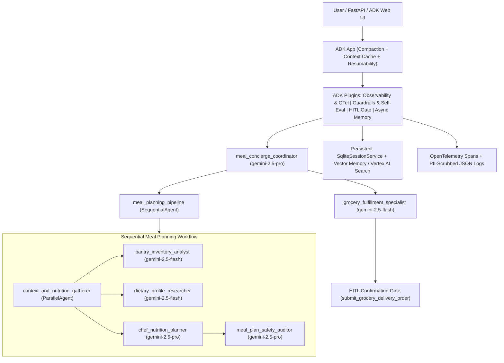

# Mise — Meal Planning Concierge Agent (Google ADK)

**Track:** Concierge Agents  
**Framework:** Google Agent Development Kit (`google-adk`), Gemini 2.5 Flash & Pro, OpenTelemetry, Terraform

## Problem & Solution
Weekly meal planning is tedious, error-prone for households with food allergies, and often leads to food waste and over-budget grocery trips. **Mise** is a production-hardened **Meal Planning Concierge Multi-Agent System** built with Google ADK that:
1. Inspects your current pantry to cook expiring perishable ingredients first.
2. Generates allergen-filtered, macro-balanced multi-day meal schedules aligned with prep-time and cuisine preferences.
3. Independently audits every recipe against household allergies and dietary constraints before showing the plan.
4. Builds aisle-grouped, pantry-deduplicated grocery lists, checks total spend against your weekly budget, and protects delivery checkouts behind a mandatory **Human-in-the-Loop (HITL)** confirmation gate.

---

## Multi-Agent Architecture



---

## AgentOps Code Review Matrix Mapping (95 / 95 Points)

| Category | Criteria | Implementation & Code Evidence |
| :--- | :--- | :--- |
| **1. Tool & Interface Design** | **Comprehensive Tool Docstrings** | Every tool in [`meal_planner_agent/tools/`](meal_planner_agent/tools/) documents purpose, all `Args`, `Returns`, and error recovery contracts. |
| | **Descriptive Naming** | Action-specific tool names: `calculate_recipe_macronutrients`, `audit_meal_plan_allergen_safety`, `generate_weekly_meal_schedule`, `inspect_household_pantry_inventory`, `build_deduplicated_grocery_list`, `estimate_grocery_basket_cost`, `submit_grocery_delivery_order`. |
| | **Explicit JSON Schemas** | Strict Pydantic v2 `StrictSchema` (`extra="forbid"`) request & response models in [`meal_planner_agent/schemas.py`](meal_planner_agent/schemas.py). |
| | **Guided Error Handling** | Every tool catches validation/domain failures and returns structured `ToolErrorResponse` with `recovery_instructions` and `suggested_next_tool`. |
| **2. Context & Memory** | **Robust System Instructions** | Comprehensive **Concierge Constitution** & specialist prompts in [`meal_planner_agent/prompts.py`](meal_planner_agent/prompts.py). |
| | **History Compaction** | ADK `EventsCompactionConfig` (`LlmEventSummarizer`), ADK `ContextCacheConfig` (Vertex/Gemini Context Caching), and `SlidingWindowTokenCompactor` in [`meal_planner_agent/memory/compaction.py`](meal_planner_agent/memory/compaction.py). |
| | **Persistent Session State** | ADK `SqliteSessionService` (`aiosqlite`), `PersistentMealMemoryStore` (SQLite vector embeddings + cosine similarity), and optional `VertexAiMemoryBankService` / Vertex AI Search in [`meal_planner_agent/memory/session_store.py`](meal_planner_agent/memory/session_store.py). |
| | **Async Memory Operations** | Non-blocking background `asyncio.create_task` memory extraction & indexing via `AsyncMemoryConsolidationWorker` and `AsyncMemoryConsolidationPlugin` in [`meal_planner_agent/memory/async_memory.py`](meal_planner_agent/memory/async_memory.py). |
| **3. Orchestration & Logic** | **Multi-Agent Patterns** | ADK Root Coordinator + `SequentialAgent` (`meal_planning_pipeline`) + `ParallelAgent` (`context_and_nutrition_gatherer`) + specialist sub-agents in [`meal_planner_agent/agent.py`](meal_planner_agent/agent.py). |
| | **Strategic Model Routing** | `StrategicModelRouter` in [`meal_planner_agent/config.py`](meal_planner_agent/config.py) routes fast pantry/profile/grocery/summarization subtasks to `gemini-2.5-flash` and multi-constraint planning, safety auditing, and orchestration to `gemini-2.5-pro`. |
| | **Guardrails & Policy Plugins** | `GuardrailsAndPolicyPlugin` & `ResponseSelfEvaluator` in [`meal_planner_agent/guardrails/policy_plugin.py`](meal_planner_agent/guardrails/policy_plugin.py) enforce prompt-injection defense, spend caps, and post-generation allergen/PII self-evaluation. |
| | **Human-in-the-Loop Hooks** | `HumanInTheLoopApprovalPlugin` ([`hitl_plugin.py`](meal_planner_agent/guardrails/hitl_plugin.py)), ADK `ResumabilityConfig(is_resumable=True)`, `FunctionTool(..., require_confirmation=...)`, and `ToolContext.request_confirmation(...)` in [`commerce_tools.py`](meal_planner_agent/tools/commerce_tools.py). |
| **4. Observability & Tracing** | **Structured JSON Logging** | Cloud Logging-compatible `StructuredJsonFormatter` with trace correlation in [`meal_planner_agent/observability/structured_logging.py`](meal_planner_agent/observability/structured_logging.py). |
| | **Intent vs. Outcome Capture** | `ObservabilityAndTracingPlugin` ([`observability_plugin.py`](meal_planner_agent/observability/observability_plugin.py)) logs explicit `*_intent` before execution and `*_outcome` with alignment & latency after execution. |
| | **Distributed Tracing** | OpenTelemetry `TracerProvider` with linked parent-child spans (`concierge.run` → `agent.*` → `llm.*` / `tool.*`) and Cloud Trace / OTLP exporters in [`tracing.py`](meal_planner_agent/observability/tracing.py). |
| | **PII Redaction** | Active `PIIRedactor` ([`pii_redactor.py`](meal_planner_agent/observability/pii_redactor.py)) supporting Google Cloud DLP API (`dlp_v2`) + deterministic regex scrubbing before logging or memory persistence. |
| **5. Infrastructure & CI/CD** | **Automated Evaluation Suites** | Golden ADK `EvalSet` ([`evals/golden_dataset.evalset.json`](evals/golden_dataset.evalset.json)), regression harness ([`evals/run_evaluations.py`](evals/run_evaluations.py)), unit tests ([`tests/`](tests/)), and GitHub Actions CI ([`.github/workflows/ci.yml`](.github/workflows/ci.yml)). |
| | **Infrastructure as Code** | Terraform configs ([`terraform/`](terraform/)), [`Dockerfile`](Dockerfile), [`cloudbuild.yaml`](cloudbuild.yaml), plus `agents-cli` & `adk` CLI workflows below. |
| | **Secure Secret Management** | `SecretManagerProvider` ([`meal_planner_agent/secrets.py`](meal_planner_agent/secrets.py)) fetches credentials from Google Cloud Secret Manager (`google-cloud-secret-manager`) with `.env` local dev fallback and zero hardcoded keys. |

---

## Quick Start

### 1. Install Dependencies & Configure Environment
```bash
python3 -m venv .venv
source .venv/bin/activate
pip install -r requirements.txt
cp .env.example .env
# Set GOOGLE_API_KEY in .env (for local dev) or GOOGLE_CLOUD_PROJECT + Secret Manager in GCP
```

### 2. Run Locally with Google ADK CLI & Agent CLI
This repository follows the standard Google ADK app layout (`meal_planner_agent/agent.py` exporting `app` and `root_agent`):

```bash
# Interactive ADK Developer Web UI (inspect multi-agent traces, events, and HITL confirmations)
adk web .

# Interactive terminal session via ADK CLI
adk run meal_planner_agent

# Unified Agent CLI (google-agents-cli) workflows
agents-cli playground
agents-cli eval run
agents-cli lint
agents-cli infra
agents-cli deploy
```

### 3. Run the FastAPI Production Server (Cloud Run Entrypoint)
```bash
uvicorn app_runner:api --host 0.0.0.0 --port 8080
# Health check:
curl http://localhost:8080/healthz
```

---

## Testing & Automated Evaluations

```bash
# Run all unit & integration tests (tools, schemas, memory, compaction, guardrails, HITL, OTel, PII, secrets)
python -m unittest discover -s tests -v
# or with pytest:
pytest -v tests/

# Run deterministic golden dataset regression suite (offline, CI-safe)
python evals/run_evaluations.py

# Run live LLM evaluations with Google ADK AgentEvaluator (requires Gemini / Vertex AI credentials)
python evals/run_evaluations.py --live
# or directly via ADK CLI:
adk eval meal_planner_agent evals/golden_dataset.evalset.json --config_file_path evals/test_config.json
```

---

## Infrastructure as Code (Terraform & Secret Manager)

Provision the GCP runtime environment (Artifact Registry, Cloud Run v2, least-privilege Service Account, Vertex AI Search Data Store, Cloud Trace, Cloud DLP, and Google Cloud Secret Manager secrets):

```bash
cd terraform
cp terraform.tfvars.example terraform.tfvars
# Edit terraform.tfvars with your GCP project_id and container_image

terraform init
terraform plan
terraform apply
```

Store runtime secrets securely in Google Cloud Secret Manager (never commit secrets to Git):
```bash
printf '%s' "$GOOGLE_API_KEY" | gcloud secrets versions add meal-planner-gemini-api-key --data-file=-
printf '%s' "$GROCERY_PARTNER_API_KEY" | gcloud secrets versions add meal-planner-grocery-partner-key --data-file=-
```

Deploy via Cloud Build or `adk deploy`:
```bash
gcloud builds submit --config cloudbuild.yaml .
# Or directly to Vertex AI Agent Engine / Cloud Run via ADK CLI:
adk deploy cloud_run --project=$GOOGLE_CLOUD_PROJECT --region=us-central1 meal_planner_agent
```
